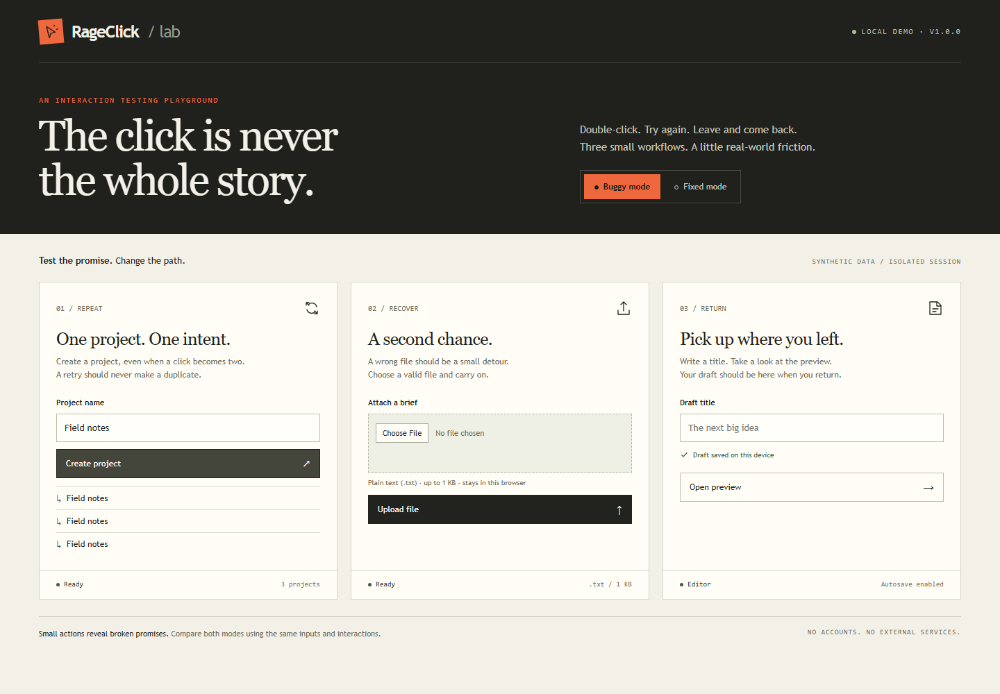

# RageClick

**Let an impatient user break your local web app. Then replay the failure.**

RageClick is an installable agent skill for testing what happens when a workflow is repeated, interrupted, or retried. Give your coding agent a local URL and a goal. It inspects the workflow, defines a concrete success condition, and uses a small Playwright runner to capture the operation sequence and its outcome.



**[Watch the recorded before/after demo](docs/demo.html)** · [Sample failure report](docs/evidence/rapid-click-buggy/report.md) · [Skill instructions](skills/rageclick/SKILL.md)

## Try the demo

Requires Node.js 22+ and Chromium installed through Playwright. Node.js 24, Windows, and Chromium 145 were tested locally.

```sh
npm --prefix skills/rageclick ci
npm --prefix skills/rageclick exec -- playwright install chromium
npm run demo
```

Open the URL printed by the server (default: `http://127.0.0.1:4317`). Switch between **Buggy mode** and **Fixed mode**. The demo uses synthetic data and a separate session for each fresh browser context.

In another terminal, from the repository root:

```sh
node skills/rageclick/scripts/run.mjs --url "http://127.0.0.1:4317/?mode=buggy" --plan examples/plans/rapid-click.json --out output/playwright/first-failure
```

The command exits **1** because three clicks create three records. Keep the server running and replay the exact plan against the fixed mode:

```sh
node output/playwright/first-failure/replay.mjs --url "http://127.0.0.1:4317/?mode=fixed" --out output/playwright/after-fix
```

This command exits **0**: one project. Output directories must be new so reruns cannot silently overwrite evidence. For a different port, run `npm run demo -- --port 4327`; automated verification uses an available ephemeral port.

## Install the skill

From this checkout, install into the project you want to test:

```sh
node scripts/install-skill.mjs --workspace /absolute/path/to/your-project
```

This copies the self-contained skill to `<your-project>/.agents/skills/rageclick` and refuses to overwrite an existing installation. Run `npm ci` and `npx playwright install chromium` in that copied directory. Restart your coding host if it does not detect the skill automatically.

In Codex, invoke:

```text
Use $rageclick on http://127.0.0.1:3000.
Goal: create a project and upload a brief using disposable test data.
Check repeated clicks, invalid-file recovery, and interruption where applicable.
Keep evidence outside my repository and do not modify the application yet.
```

The `.agents/skills` location follows [Codex's documented local skill discovery](https://developers.openai.com/codex/skills). Discovery and enabled metadata were checked through the local Codex 0.147.0 app-server. The copied runtime is independently installable; other coding hosts, operating systems, and browsers have not been validated.

**The skill interprets the goal; the CLI executes an explicit JSON plan.** The CLI does not discover buttons or infer bugs from a natural-language goal. See the [plan format](skills/rageclick/references/plans.md) when adapting it to your application.

## Five perturbations, three small fixtures

| Operation | Fixture | Contract under test |
| --- | --- | --- |
| Rapid clicks | Project creation | One intent creates one record. |
| Back and re-enter | Draft editor | A promised saved draft survives returning from preview. |
| Invalid file, then retry | Brief upload | Rejecting a bad file does not block a valid one. |
| Refresh | Draft editor | A promised saved draft survives a reload. |
| Delayed request, then retry | Project creation | Retrying while pending does not create duplicates. |

The supplied application deliberately violates these contracts in buggy mode. Fixed mode adds pending-state protection and server idempotency, clears upload state after rejection, and persists the draft in session storage. These are demonstrators, not evidence of performance on production applications.

## Evidence you can inspect

Every run produces:

- `report.md` and `report.json`: app/browser/tool versions, timestamps, viewport, step durations, expected/actual observations, and execution errors.
- `plan.json` and `replay.mjs`: exact actions with a SHA-256 plan identifier, plus a regression command.
- Numbered screenshots, `trace.zip`, and `video.webm`: actual browser output, with missing artifacts disclosed.

| Result | Exit | Meaning |
| --- | --- | --- |
| `passed` | 0 | All configured checks matched during this run. |
| `observed_failure` | 1 | An explicit expected/actual check differed. Inspect and repeat before calling it a product defect. |
| `execution_error` | 2 | A browser action, selector, prerequisite, configuration, or network boundary failed. |

In a PowerShell wrapper, read `$LASTEXITCODE` immediately after the Node command, or propagate it with `exit $LASTEXITCODE`; a parent shell can otherwise reduce nonzero results to exit 1. The JSON report always records the explicit result category.

Console errors and subjective usability impressions do not become automatic bug findings. An incorrect selector or an incorrect success condition can still create a false finding; review both against the real application contract.

## Reproduce the verification

```sh
npm test
npm run verify:demo
```

For a project-local browser cache on Windows, set `$env:PLAYWRIGHT_BROWSERS_PATH = Join-Path $PWD '.rageclick/browsers'` before browser installation and test commands. The prepared local checkout uses this cache; a fresh clone can use Playwright's default cache with the setup commands above.

The regression suite checks real browser outcomes, failure classification, zero requests reaching a second origin through redirects, generated replay behavior, and non-destructive installation. The demo matrix runs an ordinary baseline in both modes and repeats every perturbation twice in each mode: **22 browser runs**. All five buggy cases failed their assertions twice; all five fixed cases passed twice. Screenshots, traces, and videos were available for every matrix run. See [the recorded evidence](docs/verification.md).

This is fixture verification. There is no controlled same-model comparison against ordinary prompting and no demonstrated improvement in defect discovery, time, or quality on independent applications.

## Boundaries and current limits

- Use only owned fixtures or authorized disposable local environments. A local server can still reach a real backend; establish the data boundary before submitting anything.
- The runner accepts loopback URLs and guards the exact HTTP(S) origin. HTTP redirects, including same-origin redirects, are stopped before following them. Service workers and WebSockets are blocked. This is not an operating-system network sandbox.
- Responses are buffered through Playwright's API transport with transport retries disabled. Streaming, bandwidth throttling, packet loss, browser cookie/credential policy validation, and multi-origin authentication are unsupported. The delay template adds a bounded request delay only.
- Fresh browser contexts reset browser storage. They do not reset an arbitrary application's database. The included server isolates synthetic records by session cookie.
- Trace archives and screenshots can contain private application data. Review them before sharing. Captured evidence is local by default; nothing is uploaded.

Projects such as [gstack](https://github.com/garrytan/gstack) cover broader browser QA, and [usability-test-skill](https://github.com/Rob7850/usability-test-skill) covers user-flow evaluation. RageClick focuses on replaying objective failures caused by changed interaction sequences. It uses Playwright directly and does not replace a browser automation platform.

## Development

The skill and its runtime live in `skills/rageclick`; the three-scene fixture lives in `demo`; reproducible plans live in `examples/plans`. There are no build steps or external demo services. Keep generated run artifacts in ignored `output/` directories. Submit a minimal plan and the contract it exercises when reporting a defect; remove private data first.

MIT licensed. This checkout is a local release candidate; no public repository, hosted service, or release is implied by this documentation.
